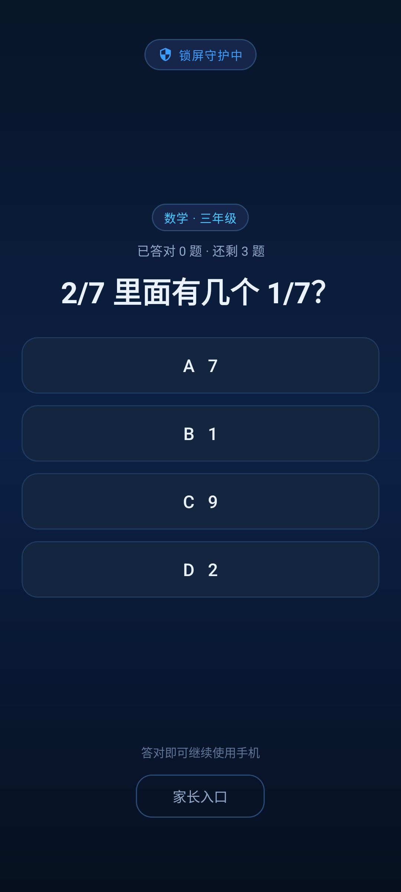
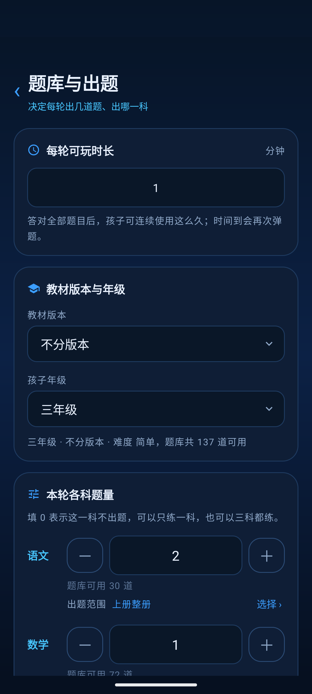
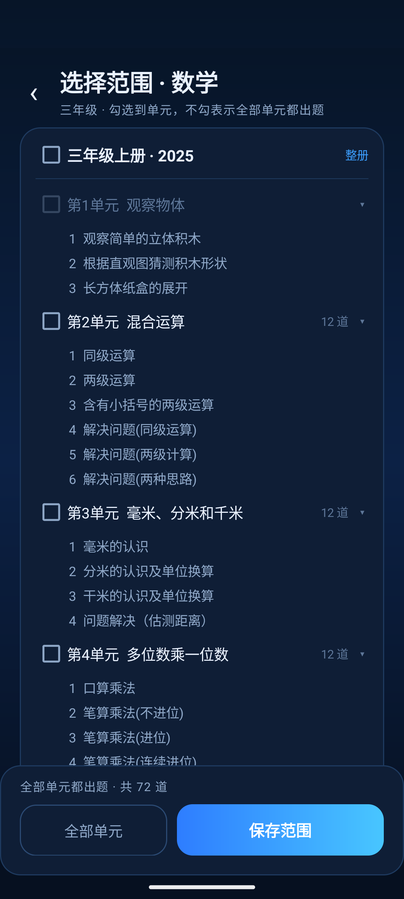
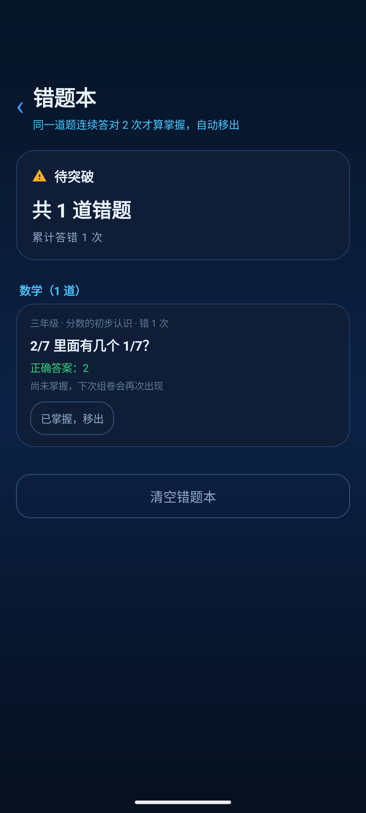
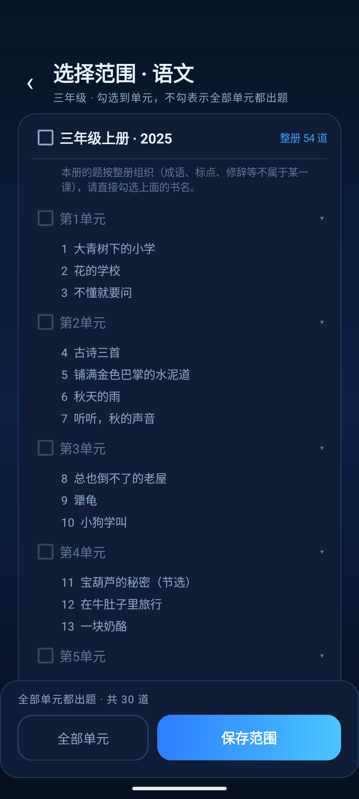

# KidLock · 儿童手机管控

> 把「玩手机的时间」变成「答对题才给」。
> 一款 Android 原生（Kotlin）的本地家长管控工具：亮屏先答题，答对解锁 N 分钟，到点自动锁回。

[](LICENSE)
[](#适配范围与已知边界)
[](#隐私与安全)
[](CHANGELOG.md)

KidLock 不做「一刀切没收手机」，而是把屏幕时间变成一项需要付出努力才能获得的东西：
孩子想玩，先做几道当前年级的题；做完才能解锁，时间一到自动回到答题页。
题目范围、每轮时长、各科题量都由家长在本地设置，**没有服务器、没有账号云同步、不申请网络权限**。

> 开源仓库：<https://github.com/Samsky123/KidLock>
> 适合家长在自己的手机上使用。请只用于自己家庭的设备，不要用于监控他人。

---

## 目录

- [功能](#功能)
- [界面](#界面)
- [工作原理](#工作原理)
- [安装（普通用户）](#安装普通用户)
- [可选的强力锁](#可选的强力锁需要-adb)
- [从源码构建](#从源码构建)
- [项目结构](#项目结构)
- [隐私与安全](#隐私与安全)
- [适配范围与已知边界](#适配范围与已知边界)
- [常见问题](#常见问题)
- [参与贡献](#参与贡献)
- [许可](#许可)

---

## 功能

| 模块 | 说明 |
|---|---|
| **整机答题解锁** | 亮屏 / 开机 / 使用到期都先进入答题页，答对全部题目才解锁；解锁时长由家长设定 |
| **三科题库** | 内置 793 道小学一至六年级语文、数学、英语题，覆盖人教版、苏教版、北师大版、外研版、译林版 |
| **按科配额** | 语文 / 数学 / 英语三个数字框，填 `0` 即该科不抽；例如「语文 2 + 数学 1 + 英语 1」= 本轮 4 题 |
| **教材目录选题** | 按「册 → 单元 → 课」浏览人教版目录（30 册 / 211 单元 / 882 课），可只练当前单元 |
| **难度上限** | 每题分 1 易 / 2 中 / 3 难，家长可限制孩子只抽到不超过某难度的题 |
| **错题本** | 答错自动入本并排到本轮队尾；连续答对 2 次才算掌握；支持「优先出错题」 |
| **按 App 限时** | 基于 UsageStatsManager 统计抖音等应用的当日使用时长，超时即弹题（需授权「使用情况访问」） |
| **家长账号** | 本地账号 + PBKDF2 密码哈希，登录才能改设置；连续输错 5 次锁定 60 秒 |
| **强力锁（可选）** | 配置为 Device Owner 后启用 Lock Task，Home / 最近任务 / 通知栏在系统层失效 |

## 界面

| 答题锁屏 | 题库与出题 | 按单元选范围 |
|---|---|---|
|  |  |  |

| 错题本 | 语文整册范围 |
|---|---|
|  |  |

界面为深色科技蓝风格，各页面统一色板与圆角卡片；截图来自 Android 14 模拟器（1080×2400）。

## 工作原理

```text
开机 / 亮屏 / 到点
      │
      ▼
LaunchActivity（答题页）── 按科配额从题库抽题（可限定教材范围、难度、错题优先）
      │  答错 → 该题回到本轮队尾，必须答对才能结束
      ▼
   全部答对 ──► 写入 unlock_until，启动 TimerService，解锁屏幕
                        │
                        ▼
              前台服务每秒倒计时；同时检查受限 App 的当日用量
                        │
                  到期 / 超时 ──► 重新拉起答题页
```

- **防退出三层**：隐藏系统栏 → 拦截返回键 → Home 后自动拉回（约 0.1–0.7 秒）。
- **强力锁**：配置 Device Owner 后调用 `startLockTask()`，从系统层面禁用 Home / 最近任务 / 通知栏。
- **纯本地**：配置与题库都在 `SharedPreferences` / `assets`，没有联网代码，也没有第三方统计 SDK。

更细的模块划分与数据流见 [docs/技术说明.md](docs/技术说明.md)。

## 安装（普通用户）

1. 打开 [Releases](https://github.com/Samsky123/KidLock/releases) 下载最新的 `KidLock-vX.Y.Z.apk`。
2. 在手机上点开 APK，按提示允许「安装未知应用」。
3. 打开 App，首次进入会要求**创建家长账号**（密码至少 6 位）。
4. 进入家长设置：设定每轮时长、教材版本、年级、各科题量，然后保存。
5. 按页面提示开启**「到点弹题」权限**（悬浮窗）——不开的话到点不会自动弹题。
6. 退出登录，把手机交给孩子即可。

完整的分步说明、国产 ROM 权限设置、忘记密码与卸载方法见 **[安装教程](docs/安装教程.md)**。

> 只从本仓库 Releases 下载安装包。第三方改包可能植入广告或窃取数据。

## 可选的强力锁（需要 adb）

普通安装已经能做到「Home 后自动拉回」，但 Home 键本身仍会闪一下桌面。
如果希望 Home / 最近任务 / 通知栏彻底失效，可把 App 配成 **Device Owner**：

```bash
adb shell dpm set-device-owner com.example.kidlock/.AdminReceiver
```

前提与限制：

- 手机上**不能存在任何账号**（系统账号、Google 账号，以及抖音/小红书等应用内账号都算），
  最稳妥的做法是恢复出厂 → 跳过账号登录 → 安装本应用 → 执行命令。
- 设置成功后，`adb uninstall` 和应用商店卸载都会失败，这是 Android 的防滥用设计。
- **解除方式**：家长登录后，在「防退出（强力锁）」卡片点「解除强力锁」。
  设上之后 `adb shell dpm remove-active-admin` 会被系统拒绝。
- 想彻底恢复普通手机，可在解除强力锁后卸载，或恢复出厂设置。

## 从源码构建

**环境要求**

| 项 | 版本 |
|---|---|
| JDK | 17 |
| Android SDK | Platform 34、Build-Tools 34.0.0 |
| Gradle | 8.9（仓库已带 Wrapper） |
| minSdk / targetSdk | 24 / 33 |

**命令行构建**

```bash
git clone <本仓库地址>
cd KidLock

export JAVA_HOME=/path/to/jdk-17
export ANDROID_HOME=/path/to/Android/sdk

./gradlew assembleDebug
# 产物：app/build/outputs/apk/debug/app-debug.apk
```

也可以直接执行仓库内脚本（会自动检查环境）：

```bash
./build_apk.sh              # debug
./build_apk.sh --offline    # 依赖已缓存时离线构建
```

**Android Studio**：直接 `Open` 仓库根目录，等待 Gradle Sync 完成后 Run 即可。

**打 release 包（可选）**

1. 生成自己的密钥库：
   ```bash
   keytool -genkeypair -v -keystore kidlock-release.jks -alias kidlock \
     -keyalg RSA -keysize 2048 -validity 10000
   ```
2. 复制 `keystore.properties.example` 为 `keystore.properties`，填入路径与口令。
   （该文件已被 `.gitignore` 排除，不会误提交。）
3. `./gradlew assembleRelease`。

## 项目结构

```text
.
├── app/src/main/
│   ├── java/com/example/kidlock/
│   │   ├── LaunchActivity.kt        # 答题锁屏：抽题、判题、队列、解锁
│   │   ├── TimerService.kt          # 前台倒计时 + 受限 App 用量检测 + 逃逸回弹
│   │   ├── ParentActivity.kt        # 家长首页（登录后）
│   │   ├── QuizSettingsActivity.kt  # 时长 / 版本 / 年级 / 三科题量 / 难度
│   │   ├── ScopePickerActivity.kt   # 册 → 单元 → 课 范围选择
│   │   ├── WrongBookActivity.kt     # 错题本
│   │   ├── AppLimitActivity.kt      # 按 App 限时
│   │   ├── AuthStore.kt             # 本地账号、PBKDF2、失败限流
│   │   ├── Catalog.kt / Question.kt / WrongBook.kt / QuizSettings.kt
│   │   └── LockGuard.kt / AdminReceiver.kt / BootReceiver.kt
│   ├── assets/
│   │   ├── questions.json           # 题库（98 组 / 793 题）
│   │   └── catalog.json             # 教材目录（30 册 / 211 单元 / 882 课）
│   └── res/                         # 布局、色板、矢量图标
├── tools/                           # 题库与目录的生成脚本（Python 3）
├── docs/                            # 安装教程、技术说明、截图
├── build_apk.sh
└── keystore.properties.example
```

题库与目录都是生成产物，可复现：

```bash
python3 tools/gen_bank.py         # 重新生成 questions.json
python3 tools/fetch_catalog.py    # 抓取教材目录 → tools/catalog_raw.json
python3 tools/build_catalog.py    # 合并为 assets/catalog.json 并写入 scopes
```

## 隐私与安全

- **不申请 `INTERNET` 权限**：应用在系统层面就无法联网，不存在上传数据的可能。
- **无广告、无统计 SDK、无第三方登录**。
- 家长密码使用 **PBKDF2-HMAC-SHA256（10 万次迭代 + 16 字节随机盐）** 存储，不保存明文。
- 登录失败 5 次锁定 60 秒，计数持久化，重启应用不能绕过。
- 已关闭 `allowBackup`，家长配置与密码哈希不会被系统备份带走。
- 所有数据仅保存在本机应用私有目录，卸载即清除。
- 应用需要的高敏权限及用途：

| 权限 | 用途 | 是否必需 |
|---|---|---|
| `SYSTEM_ALERT_WINDOW`（悬浮窗） | Android 10+ 允许应用从后台拉起答题页 | **必需**，否则到点不弹题 |
| `PACKAGE_USAGE_STATS`（使用情况访问） | 统计受限 App 的当日使用时长 | 仅「按 App 限时」需要 |
| `POST_NOTIFICATIONS` | 显示前台倒计时通知（Android 13+） | 建议开启 |
| `RECEIVE_BOOT_COMPLETED` | 开机后先答题 | 建议开启 |
| `USE_FULL_SCREEN_INTENT` | 锁屏状态下拉起答题页 | 建议开启 |

## 适配范围与已知边界

- **系统**：Android 7.0（API 24）及以上，主要在 Android 14 上验证；国产 ROM 需额外允许自启动与后台运行。
- **普通模式不是「不可绕过」**：懂技术的孩子可以通过安全模式、恢复出厂、adb 卸载等方式绕过；
  只有 Device Owner + Lock Task 才能做到系统级防退出与防卸载。
- **抽题精度到单元**：教材目录可精确到课，但题库按知识点组织，抽题粒度数学/英语为单元、语文为整册。
- **按 App 限时依赖系统用量统计**：部分 ROM 会延迟或截断 UsageStats，需在真机验证。
- **未上架应用商店**：Device Owner 属于企业/MDM 能力，Google Play 与国内商店均限制普通应用申请。
- **教材目录**：仅包含册 / 单元 / 课的名称结构，不含教材正文，数据整理自公开目录页；
  如权利人提出异议，可删除 `assets/catalog.json` 并移除范围选择入口。
- 本项目是家长辅助工具，不构成任何形式的儿童监控服务；请遵守当地法律与平台规则。

## 常见问题

**到点不弹题？**
检查是否开启「显示在其他应用上层」权限；国产 ROM 还需允许自启动、关闭电池优化。详见安装教程。

**按 Home 还是能回到桌面？**
普通模式只能「按了再拉回」，无法拦截系统保留键。需要彻底禁止请配置 Device Owner。

**忘记家长密码？**
本地没有找回渠道。可 `adb shell pm clear com.example.kidlock` 清空数据（配置与错题本会一起丢失），
或卸载重装；若已配置强力锁，先在家长页解除，否则需恢复出厂。

**安装时提示「应用未安装 / 签名不一致」？**
先卸载旧版本再安装。不同来源的 APK 签名不同，不能覆盖安装。

**会收集孩子的数据吗？**
不会。应用没有网络权限，所有数据只在本机。

## 参与贡献

欢迎提 Issue 与 PR：

- 题库补充：修改 `tools/gen_bank.py` 后重新生成，附上题目正确性说明。
- 教材换版：更新 `tools/build_catalog.py` 里的 `MAPPING` 映射表。
- 新机型适配：请在 Issue 中注明机型、ROM 版本、复现步骤与 `adb logcat` 关键日志。

提交前请确保 `./gradlew assembleDebug` 通过，并避免提交任何签名文件、口令或个人配置。

## 许可

[MIT](LICENSE)。可自由使用、修改与分发，请保留版权声明。
